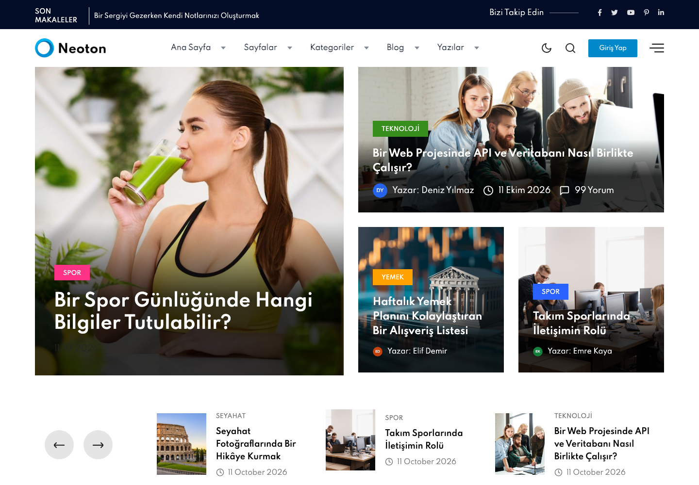
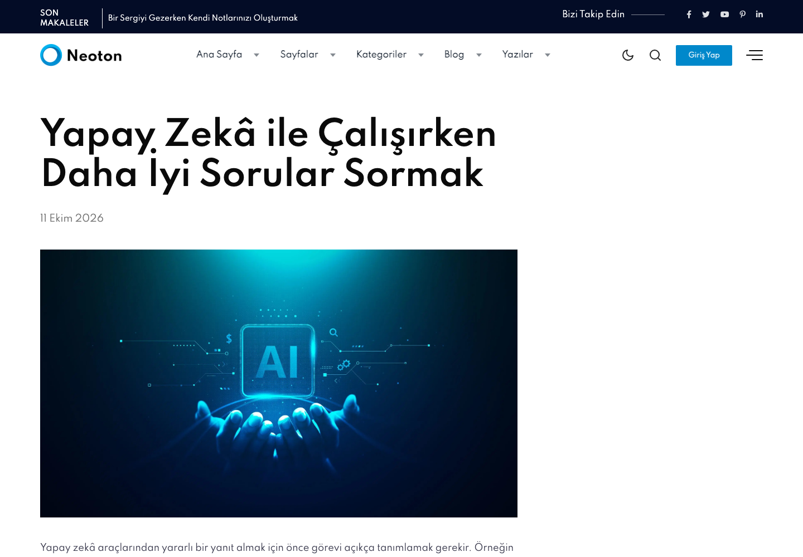
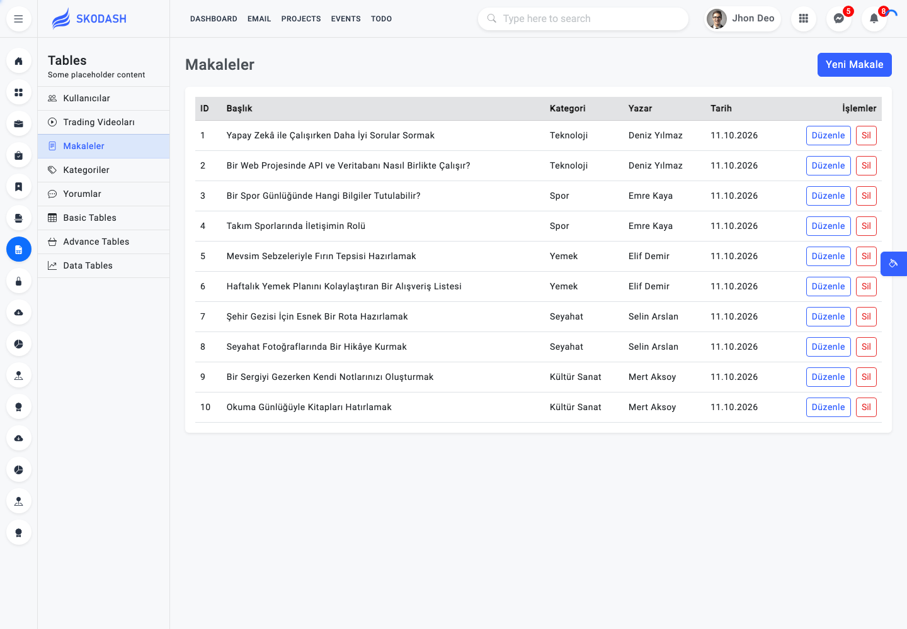
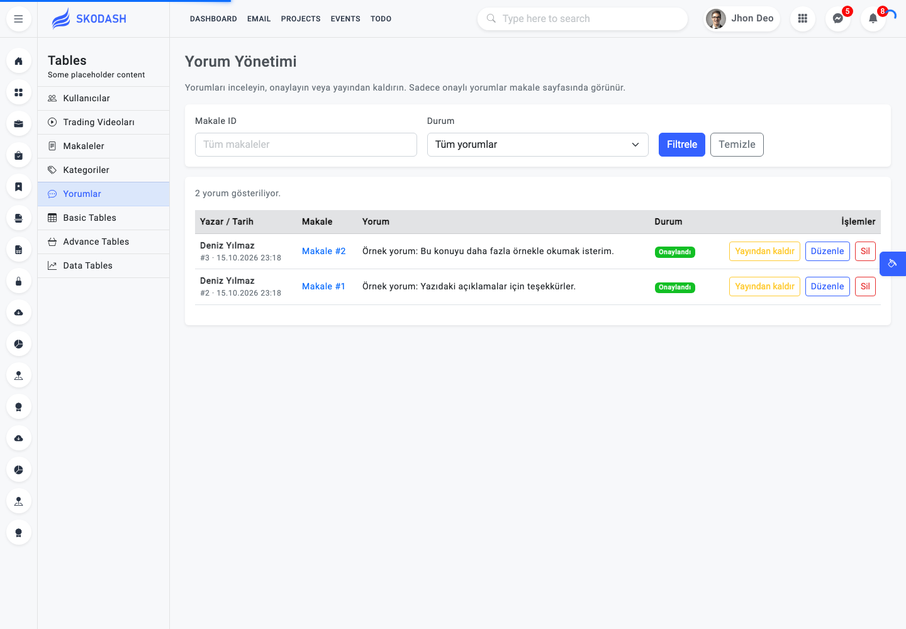
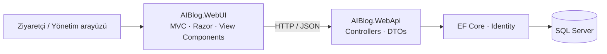

# AIBlog · ASP.NET Core Blog & Yönetim Paneli

ASP.NET Core Web API ile geliştirilen bir blog uygulaması ve bu API’yi tüketen MVC yönetim arayüzü. Makaleler, kategoriler, yazarlar, videolar ve yorumlar ayrı bir API üzerinden yönetilir; ziyaretçi arayüzü içerikleri Razor View Component’leriyle sunar.


BTK eğitim çalışmaları kapsamında geliştirilen bu proje, API ve arayüz ayrımı, Entity Framework Core, DTO kullanımı ve component tabanlı MVC sayfaları üzerine uygulamalı bir örnektir.

> Proje geliştirme aşamasındadır. Admin erişim kontrolü ve kullanıcı oturum akışı henüz tamamlanmamıştır. Uygulama adı AIBlog olsa da mevcut sürümde bir yapay zekâ servisi entegrasyonu bulunmaz.

## Ekran görüntüleri

Görseller, yerel SQL Server veritabanına bağlı çalışan uygulamadan alınmıştır. Ekranlardaki içerikler geliştirme verilerini gösterir.

### Blog ana sayfası



<details>
<summary>Makale detayı ve yönetim ekranlarını görüntüle</summary>

### Makale detayı



### Makale yönetimi



### Yorum yönetimi



</details>

## Özellikler

### Ziyaretçi arayüzü

- Slider, trend içerikler ve son makaleler için ayrı bileşenler.
- Kategorilere göre içerik sunumunu destekleyen API sorguları.
- Makale başlığı, tarihi, görseli ve metnini gösteren detay sayfası.
- Makale bazında onaylanmış yorumların listelenmesi.
- Oturum kontrolüne bağlı yorum formu; tam kullanım için giriş altyapısının tamamlanması gerekir.

### Yönetim paneli

- **Makaleler:** Listeleme, oluşturma, düzenleme, kategori ve yazar atama, silme.
- **Kategoriler:** Listeleme, oluşturma, düzenleme ve silme.
- **Kullanıcılar:** Kullanıcı oluşturma, profil bilgilerini düzenleme ve silme. Kullanıcı silinirken makaleler korunur, yazar bağlantıları kaldırılır.
- **Videolar:** Başlık, küçük görsel ve video URL bilgilerinin yönetimi.
- **Yorumlar:** Makale ID’si ve onay durumuna göre filtreleme, onaylama, yayından kaldırma, metin düzenleme ve silme.

Yeni yorumlar **Onay Bekliyor** durumuyla kaydedilir. Yorum onaylandığında makale detayında görünür; yayından kaldırıldığında yeniden onay bekleyen duruma geçer.

## Teknolojiler ve mimari

| Katman | Kullanılan yapı |
| --- | --- |
| Backend | ASP.NET Core Web API · .NET 10 |
| Veritabanı | Microsoft SQL Server |
| Veri erişimi | Entity Framework Core 10 · Code First Migrations |
| Kullanıcı modeli | ASP.NET Core Identity · `AppUser` |
| Model dönüşümü | AutoMapper |
| API dokümantasyonu | OpenAPI · Swagger UI |
| Arayüz | ASP.NET Core MVC · Razor Views · View Components |
| API iletişimi | `IHttpClientFactory` · JSON |
| Görsel yapı | Bootstrap tabanlı blog ve admin şablonları |



```text
aspnet-api-btk/
├── AIBlog.slnx
├── dotnet-tools.json          # EF Core CLI araç tanımı
├── AIBlog.WebApi/
│   ├── Context/              # BlogAIContext
│   ├── Controller/           # API endpoint’leri
│   ├── Dtos/                 # İstek ve yanıt modelleri
│   ├── Entities/             # Veritabanı modelleri
│   ├── Mapping/              # AutoMapper profilleri
│   └── Migrations/           # Veritabanı şema geçmişi
└── AIBlog.WebUI/
    ├── Controllers/          # MVC sayfa ve form işlemleri
    ├── Dtos/                 # API iletişim modelleri
    ├── ViewComponents/       # Tekrar kullanılabilir sayfa bileşenleri
    ├── Views/                # Blog ve yönetim ekranları
    └── wwwroot/              # CSS, JavaScript, görseller ve şablonlar
```

## Yerel kurulum

### Gereksinimler

- .NET 10 SDK
- Erişilebilir bir Microsoft SQL Server örneği
- Git
- İsteğe bağlı: Visual Studio, JetBrains Rider veya VS Code

SQL Server farklı bir makinede de çalışabilir. macOS kullanıyorsanız bağlantı bilgilerini erişebildiğiniz SQL Server sunucusuna göre düzenleyin.

### 1. Depoyu indirin

```bash
git clone https://github.com/seyitbugraerden/aspnet-api-btk.git
cd aspnet-api-btk
dotnet restore AIBlog.slnx
```

### Docker ile SQL Server (isteğe bağlı)

Yerel SQL Server kurulumu yerine veritabanını Docker üzerinde çalıştırabilirsiniz. Bu akışta yalnızca SQL Server konteynerde, API ve WebUI ise .NET CLI ile makinenizde çalışır. Depoda uygulamalar için Dockerfile veya Docker Compose yapılandırması bulunmaz.

Docker Desktop veya Docker Engine çalışırken aşağıdaki komutları Bash/Zsh terminalinde uygulayın. `YOUR_STRONG_LOCAL_PASSWORD` değerini SQL Server parola kurallarına uygun kendi yerel parolanızla değiştirin:

```bash
export MSSQL_SA_PASSWORD='YOUR_STRONG_LOCAL_PASSWORD'
docker volume create aiblog-sql-data
docker run --name aiblog-sql \
  --env ACCEPT_EULA=Y \
  --env MSSQL_PID=Developer \
  --env MSSQL_SA_PASSWORD \
  --publish 127.0.0.1:1433:1433 \
  --volume aiblog-sql-data:/var/opt/mssql \
  --detach mcr.microsoft.com/mssql/server:2022-latest
```

Named volume veritabanı dosyalarını konteynerden ayrı tutar. SQL Server hazır olduğunda aşağıdaki bağlantı ayarında kullanıcı adı olarak `sa`, parola olarak seçtiğiniz değeri kullanın; ardından migration adımına geçin. Aynı isimde bir konteyner zaten varsa yeniden oluşturmak yerine `docker start aiblog-sql` komutunu kullanın.

```bash
docker ps --filter name=aiblog-sql
docker logs --tail 30 aiblog-sql
docker stop aiblog-sql
docker start aiblog-sql
```

SQL Server Linux konteynerleri için Microsoft’un desteklediği mimari x86-64’tür; Apple Silicon üzerinde emülasyon resmi destek kapsamında değildir. Kurulum ayrıntıları ve platform gereksinimleri için [Microsoft SQL Server Docker rehberini](https://learn.microsoft.com/en-us/sql/linux/quickstart-install-connect-docker?view=sql-server-ver16) inceleyin.

### 2. Veritabanı bağlantısını tanımlayın

API, bağlantı bilgisini `ConnectionStrings:BlogAI` anahtarından okur. Yerel geliştirmede bilgiyi User Secrets üzerinden tanımlayabilirsiniz:

```bash
dotnet user-secrets set "ConnectionStrings:BlogAI" "Server=localhost,1433;Database=BlogAI;User Id=YOUR_DB_USER;Password=YOUR_DB_PASSWORD;Encrypt=True;TrustServerCertificate=True" --project AIBlog.WebApi
```

Örnek değerleri kendi sunucu ve kullanıcı bilgilerinizle değiştirin. `TrustServerCertificate=True` burada yerel geliştirme bağlantısı içindir. Gerçek bağlantı bilgilerini Git’e eklemeyin.

### 3. Veritabanını oluşturun

EF Core CLI aracını yükleyin (zaten uyumlu bir sürüm kuruluysa yükleme adımını atlayabilirsiniz):

```bash
dotnet tool install --global dotnet-ef --version 10.0.12
dotnet ef database update --project AIBlog.WebApi --startup-project AIBlog.WebApi
```

Migration’lar şemayı oluşturur; hazır demo veri veya admin hesabı oluşturma adımı bulunmaz. Başlangıç verilerini yönetim ekranlarından ekleyebilirsiniz. Mevcut bir veritabanını güncelliyorsanız önce yedek alın ve migration’ları inceleyin.

### 4. API’yi başlatın

İlk terminalde:

```bash
dotnet run --project AIBlog.WebApi --launch-profile http
```

### 5. WebUI’ı başlatın

İkinci terminalde:

```bash
dotnet run --project AIBlog.WebUI --launch-profile http
```

| Sayfa | Yerel adres |
| --- | --- |
| Blog ana sayfası | http://localhost:5045/Default/Index |
| Makale listesi | http://localhost:5045/Article/ArticleList |
| Admin paneli | http://localhost:5045/Admin/Index |
| Makale yönetimi | http://localhost:5045/AdminArticle/ArticleList |
| Kategori yönetimi | http://localhost:5045/Category/CategoryList |
| Kullanıcı yönetimi | http://localhost:5045/User/UserList |
| Video yönetimi | http://localhost:5045/TradingVideo/TradingVideoList |
| Yorum yönetimi | http://localhost:5045/AdminComment/CommentList |
| Swagger UI | http://localhost:5159/swagger |
| OpenAPI belgesi | http://localhost:5159/openapi/v1.json |

Varsayılan `/` adresi MVC başlangıç sayfasını açar; blog için `/Default/Index` yolunu kullanın. Swagger ve OpenAPI yalnızca `Development` ortamında sunulur. WebUI içindeki API istekleri şu anda `http://localhost:5159` adresine bağlıdır; API portunu değiştirirseniz bu adresleri de güncellemeniz gerekir.

## API’ye kısa bakış

| Kaynak | Endpoint | İşlemler |
| --- | --- | --- |
| Makaleler | `/api/Articles` | Listeleme, ID ile getirme, oluşturma, güncelleme, silme |
| Kategoriler | `/api/Categories` | Listeleme, ID ile getirme, oluşturma, güncelleme, silme |
| Kullanıcılar | `/api/Users` | Listeleme, ID ile getirme, oluşturma, güncelleme, silme |
| Videolar | `/api/TradingVideos` | Listeleme, ID ile getirme, oluşturma, güncelleme, silme |
| Yorumlar | `/api/Comments` | Listeleme, filtreleme, ID ile getirme, oluşturma, güncelleme, silme |
| Kayıt | `/Registers` | Kullanıcı kaydı |

**Güncelleme rotası:** Makaleler için `PUT /api/Articles`, diğer yönetim kaynakları için `PUT /api/{Kaynak}/{id}` kullanılır. İstek şemaları Swagger UI üzerinden incelenebilir.

Bir makalenin onaylanmış yorumlarını listelemek için:

```http
GET /api/Comments?articleId=1&confirmedOnly=true
```

Yorum oluşturma isteği:

```json
{
  "articleId": 1,
  "appUserId": "EXISTING_USER_ID",
  "commentDetail": "Makale için teşekkürler!"
}
```

`articleId` ve `appUserId` mevcut kayıtlara ait olmalıdır. Yorum metni zorunludur ve en fazla 4000 karakter olabilir. Tarih ve başlangıç onay durumu API tarafından atanır.

## Mevcut sınırlar

- Admin rol denetimi ve kullanıcı giriş/oturum akışı tamamlanmamıştır; uygulama bu haliyle herkese açık üretim ortamına uygun değildir.
- Ana sayfa yerleşimini belirleyen slider ve trend gibi makale işaretleri henüz admin formundan yönetilemez.
- Liste endpoint’lerinde sayfalama bulunmaz; merkezi hata yönetimi ve API adresinin yapılandırmaya taşınması geliştirme alanlarıdır.
- Kullanıcı silindiğinde ilişkili yorumlar da mevcut şema gereği silinir; makaleler korunur.
- Otomatik test projesi bulunmaz. Derleme, davranışların uçtan uca doğrulandığı anlamına gelmez.

## Derleme

```bash
dotnet build AIBlog.slnx
```

## Geliştirici

[Seyit Buğra Erden](https://github.com/seyitbugraerden) · [GitHub deposu](https://github.com/seyitbugraerden/aspnet-api-btk)
